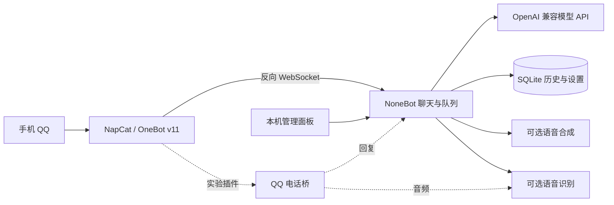

# 技术方案说明书

## 架构与数据流

`settings.py` 校验 TOML；`bot.py` 启动 NoneBot 并生成协议端配置；`chat.py` 处理消息、上下文和队列；`storage.py` 保存 SQLite；`dashboard.py` 和 `web/` 提供本机面板；`speech.py`、`recognition.py`、`voice_call.py` 提供可选语音能力；`continuity.py` 负责摘要及情绪状态；`harness.py` 和 `desktop_bridge.py` 实现受限任务工具。第三方电话桥独立位于 `third_party/qq-call/`，许可证和修改来源见其 NOTICE。

## 部署与限制

默认 Compose 启动 init、bot 和固定版本 NapCat，反向 WS 使用容器名 `bot`。WebUI 和面板只映射到宿主机回环地址。QQ 登录态存 Docker 卷，配置和数据库不进镜像。完整安装、网络依赖和排错见 README、TUTORIAL。

本地 GPT-SoVITS、Whisper、QQ 电话的依赖、模型和素材不随基础部署自动安装。电话实验需要额外镜像和授权文件，具体见 QQ_CALL_EXPERIMENT；构建成功不等于通话成功。重启、网络、服务商和协议变化均可能影响服务。

## 配置、安全与测试

配置用 `config.example.toml` 展示，实际 `config.toml` 不进入 Git。访问令牌、个人数据和音频不写入源码。外部网页工具受域名及内网限制；公开地址仍可能变化。测试入口为 `python -m unittest discover -v` 和电话桥 Node 测试；CI 覆盖 Python 3.10、3.11、3.12。它们不替代真实 QQ、模型 API 和音频设备验收。
